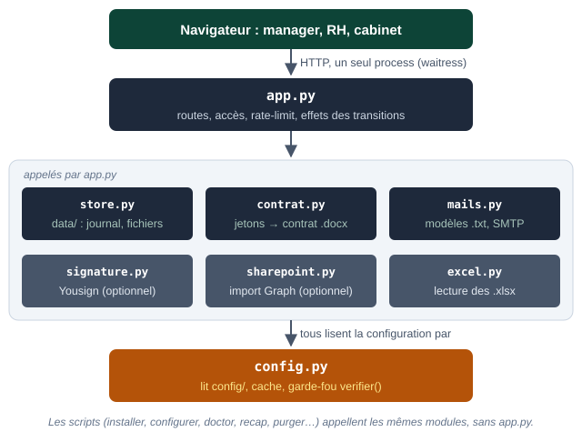
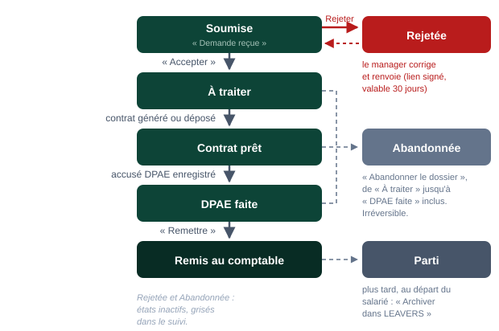
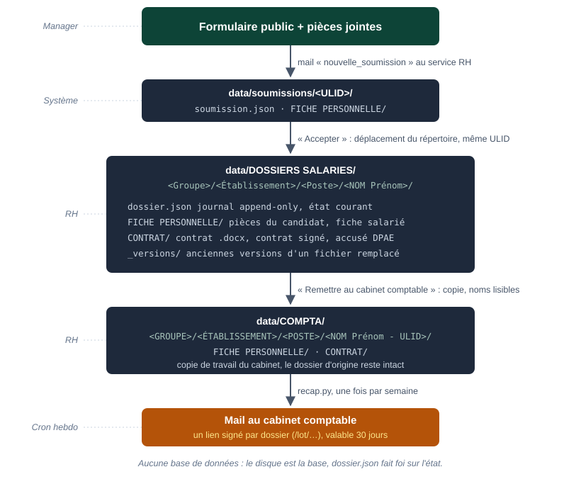
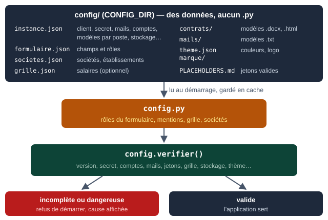
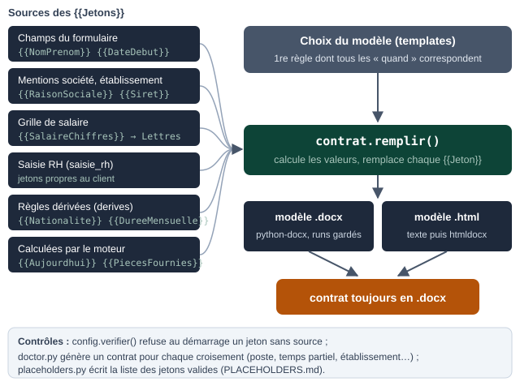
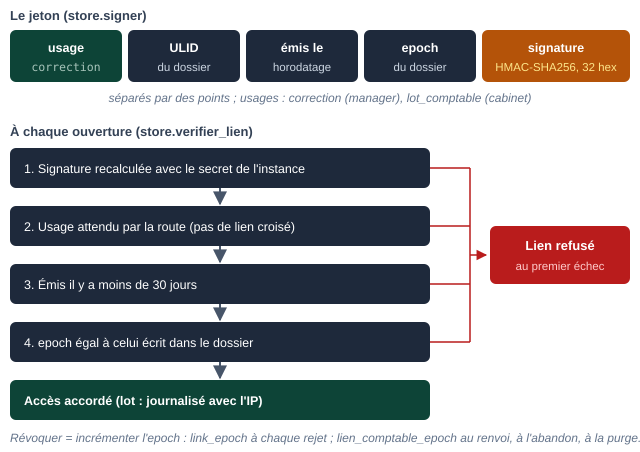
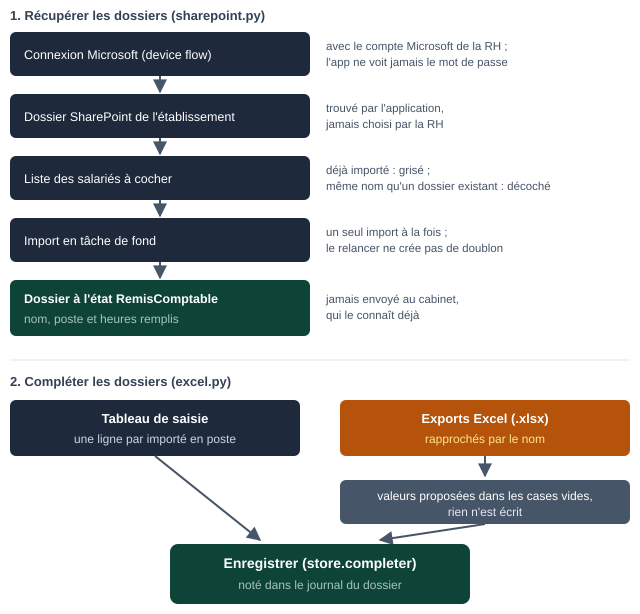
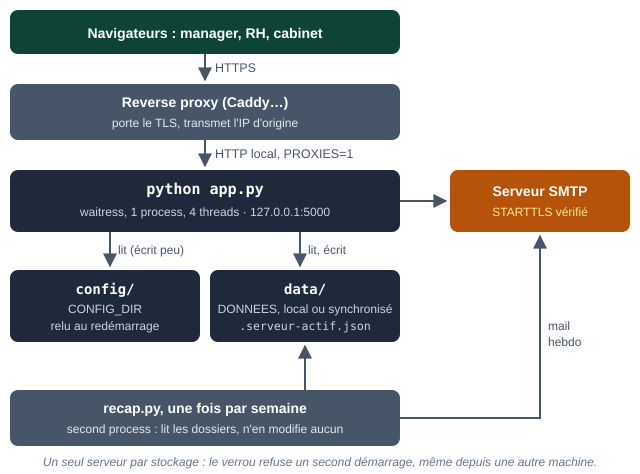

# Documentation technique — Contrat_Gen

> Pour un développeur qui reprend le code. Chaque partie tient en un schéma et quelques lignes ; le détail est dans le code et dans la configuration de démonstration (`config.demo/`).

---

## Sommaire

1. [En bref](#1-en-bref)
2. [Le parcours d'un dossier](#2-le-parcours-dun-dossier)
3. [La configuration](#3-la-configuration)
4. [La génération des contrats](#4-la-génération-des-contrats)
5. [Mails et sécurité](#5-mails-et-sécurité)
6. [L'import des salariés déjà en poste](#6-limport-des-salariés-déjà-en-poste)
7. [Installer, lancer, tester](#7-installer-lancer-tester)

---

## 1. En bref

Contrat_Gen reçoit les demandes d'embauche des managers, aide la RH à produire le contrat et la DPAE, puis transmet le dossier au cabinet comptable.



Cinq règles expliquent presque tout le code :

- **Un client = une copie du dépôt.** Chaque client a sa propre configuration (`config/`) et sa propre base MongoDB (`MONGO_DB`). Rien n'est partagé.
- **Toutes les données sont dans MongoDB.** Dossiers, pièces, contrats, comptes, sociétés : rien sur le disque du serveur, qui ne garde que `config/` en lecture seule.
- **Un seul process, de préférence.** Le journal s'écrit par compare-and-swap en base : plusieurs process ne perdent plus de données. Mais les plafonds de rate-limit sont en mémoire, donc multipliés par le nombre de process. waitress mono-process reste le lancement recommandé.
- **La configuration ne contient pas de code.** Tout ce qui change d'un client à l'autre est dans `config/`, en JSON et en modèles de documents.
- **L'application refuse de démarrer** si la configuration est incomplète, et dit pourquoi.

---

## 2. Le parcours d'un dossier

Un dossier passe par des **états** : demande reçue, à traiter, contrat prêt, DPAE faite, remis au comptable. Il peut aussi être rejeté (le manager corrige et renvoie) ou abandonné, jusqu'à la DPAE. Quand le salarié quitte l'entreprise, son dossier passe à « parti ».





Chaque dossier (un document de la collection `dossiers`) porte un **journal** : une ligne par action. Aucune ligne n'est jamais supprimée ; la purge retire seulement les commentaires et les adresses IP. L'état du dossier, c'est simplement la dernière ligne du journal.

```json
{"de": "ContratPret", "vers": "DpaeFaite", "le": "2026-09-16T12:35:24+00:00", "par": "rh"}
```

Ce qu'il faut savoir pour modifier ce code :

- Les changements d'état passent par `store.transition()`, qui refuse un passage non prévu. Quatre fonctions font exception, car elles créent ou déplacent le dossier : `valider()`, `rejeter()`, `resoumettre()` et `importer()`.
- Certaines lignes ne changent pas l'état : elles notent un événement (mail raté, fiche générée…). On les écrit avec `store.noter()`.
- Les collections MongoDB : `dossiers` (journal compris), `fichiers` (pièces et contrats, octets inline, 15 Mo maximum par fichier), `recap` (dernier mail hebdomadaire envoyé, par cabinet), `mails` (mode console seulement : le `.eml` en base), `comptes` (identifiant et hash du mot de passe), `societes` (sociétés, établissements imbriqués), `etat` (jeton SharePoint).
- Rien n'est copié ni déplacé hors de la base : le lot du cabinet (`/lot/<jeton>`) sert les pièces en direct, et un départ est simplement l'état « parti ». L'export (`/dossier/<uid>/export`, `/salaries/export`, zip en flux) recalcule l'arborescence `DOSSIERS SALARIES|LEAVERS/<groupe>/<établissement>/<poste>/<NOM Prénom>/{FICHE PERSONNELLE,CONTRAT}` depuis la config courante ; dossiers purgés et anciennes versions absents. Chaque dossier dont au moins une pièce sort reçoit une ligne `export` au journal (qui, adresse IP), écrite avant l'envoi. Chemins de 240 caractères au plus dans le zip (segments de 40, nom de pièce raccourci au besoin) : à extraire dans un dossier de 20 caractères au plus pour rester sous la limite Windows.

---

## 3. La configuration

`config.py` lit ces fichiers une fois, puis les garde en mémoire. Pour appliquer une modification, il faut **redémarrer**.

Les deux fichiers principaux :

- `instance.json` : le client, ses adresses mail, et **quel modèle de contrat utiliser pour quel poste** (`templates` : la première règle qui correspond gagne).
- `formulaire.json` : les champs du formulaire. Un champ peut alimenter un `{{Jeton}}` des contrats. Chaque pièce jointe doit avoir un `role`, qui sert à nommer le fichier.
Un exemple complet de chaque fichier se trouve dans `config.demo/`.



### Sociétés, établissements, comptes et secrets : pas dans `config/`

- Les **sociétés et leurs établissements** (mentions légales du contrat, cabinet comptable, couloir de contrat) sont dans la collection `societes`. On les saisit avec `python configurer.py --assister`, on les charge avec `python configurer.py importer-societes <fichier.json>` (`config.demo/societes.amorce.json` en est un exemple), ou on les modifie à l'écran « Établissements ». L'application ne lit plus de fichier de sociétés dans `config/`, et Supabase n'est plus utilisé.
- Les **comptes** sont dans la collection `comptes` : `python configurer.py compte <identifiant>`.
- Les **secrets** sont des variables d'environnement, jamais dans `config/` ni en base : `SECRET_KEY` (session et signature des liens), `MONGO_URI` et `MONGO_DB` (obligatoires, une base par client), `SMTP_MOT_DE_PASSE` (si `mails.mode` vaut `smtp` avec un `utilisateur`), `YOUSIGN_CLE_API` (si la signature est `yousign`). `installer.py` écrit les trois premières, avec `CONFIG_DIR`, dans un fichier d'environnement hors de `config/`.

Au démarrage, `config.verifier()` refuse de servir s'il manque une variable ; le message nomme la variable, jamais la valeur de `MONGO_URI` (elle porte le mot de passe de la base). Puis un `ping` de la base : base injoignable, refus.

---

## 4. La génération des contrats



Un modèle de contrat est un fichier `.docx` ou `.html` qui contient des jetons comme `{{NomPrenom}}`. `contrat.remplir()` remplace chaque jeton par sa valeur. Le contrat produit est toujours un `.docx`.

Trois outils évitent les mauvaises surprises :

- **Au démarrage**, un jeton qui n'a pas de source bloque le lancement.
- `python doctor.py` génère un contrat d'essai pour chaque combinaison possible (poste, temps partiel, établissement…) et signale les trous.
- `python placeholders.py` écrit `PLACEHOLDERS.md`, la liste des jetons utilisables, à donner au client qui prépare ses modèles.

---

## 5. Mails et sécurité

Les mails sont des fichiers texte dans `config/mails/`. Le démarrage refuse de servir si l'un des quatre modèles envoyés pour un dossier (`nouvelle_soumission`, `demande_validee`, `rejet`, `rappel_dpae`) est absent ou vide ; `recap_hebdo` (mail hebdomadaire, cron) n'est qu'un avertissement de `configurer.py`. Un mail qui ne part pas n'arrête jamais l'action en cours : l'échec est noté dans le journal du dossier et affiché à l'écran. Le mail de rejet va à l'établissement, ou à la RH si l'établissement n'a pas d'adresse.

Le manager et le cabinet comptable n'ont pas de compte. Ils reçoivent un **lien signé**, valable 30 jours :



Les autres protections :

- Les comptes RH sont dans la collection `comptes`, avec des mots de passe hachés.
- Le formulaire et la connexion limitent le nombre d'essais par adresse IP.
- Les fichiers envoyés sont limités en type (PDF, images) et en taille, et renommés par l'application.

---

## 6. L'import des salariés déjà en poste

Les salariés embauchés avant l'outil ont déjà un dossier sur le SharePoint du client (le jeton de connexion est gardé dans la collection `etat`). Deux écrans les font entrer dans l'application. Ils n'existent que si `instance.json` contient un bloc `sharepoint`.



À retenir :

- La RH se connecte avec son propre compte Microsoft. L'application ne voit jamais son mot de passe. Il faut se déconnecter après l'import.
- Un dossier importé arrive directement à l'état « remis au comptable », mais il n'est **jamais** envoyé au cabinet, qui le connaît déjà.
- Relancer un import ne crée pas de doublon.
- L'Excel ne fait que **proposer** des valeurs. Rien n'est enregistré tant que la RH n'a pas cliqué sur « Enregistrer ».
- Les modules concernés : `sharepoint.py` (import) et `excel.py` (lecture des fichiers Excel). Il faut aussi installer `requirements-sharepoint.txt`.

---

## 7. Installer, lancer, tester

```bash
pip install -r requirements.txt
export MONGO_URI="mongodb+srv://…" MONGO_DB=basilic   # la base neuve du client
python installer.py "Basilic Café" /srv/basilic       # compte rh en base, config/ et fichier d'environnement
python configurer.py --env /srv/basilic/.env            # dit ce qu'il manque dans la configuration
python doctor.py --env /srv/basilic/.env                # vérifie les modèles de contrat
PROXIES=1 python app.py --env /srv/basilic/.env         # lance le serveur derrière un reverse proxy
```



- `DEBUG=1 python app.py` lance le serveur de développement.
- `recap.py` envoie le mail hebdomadaire au cabinet. Il doit être planifié chaque semaine (cron ou tâche Windows), sinon le cabinet ne reçoit rien.
- `PROXIES` indique combien de reverse proxies sont devant l'application, pour lire la vraie adresse IP des visiteurs.
- Le fichier d'environnement se passe à chaque commande avec `--env <dossier>/.env` (`python app.py --env /srv/basilic/.env`), sous Windows comme sur le VPS. C'est `config.py` qui le lit, avant tout le reste : une ligne `CLE=valeur` coupée au premier `=`, espaces et guillemets englobants retirés ; une ligne illisible arrête la commande. Une variable déjà posée dans l'environnement (par exemple par `EnvironmentFile=` de systemd) l'emporte sur le fichier. Sur le VPS, le fichier doit être lisible par le compte du service, en mode 600.
- Pour sauvegarder, il faut la base (`mongodump`, ou la sauvegarde de l'hébergeur), `config/` et le fichier d'environnement. Les sauvegardes de la base gardent les données jusqu'à leur propre expiration, même après une purge. Pour mettre à jour, `git pull` puis redémarrer.

**Tests.** Ils tournent sur une base en mémoire (`mongomock`, `pip install -r requirements-dev.txt`). Chaque fichier de `tests/` se lance seul (`python tests/test_parcours.py`). La suite est bonne quand tous terminent sans erreur. Si vous ajoutez un fichier `.py` à la racine, ajoutez-le aussi dans `tests/test_clients.py`.

